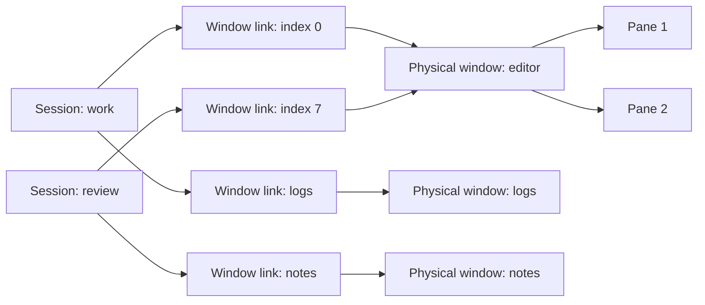

<!-- libtmux-logo -->
<div align="center">
  <picture>
    <source srcset="docs/assets/logo.svg" type="image/svg+xml">
    
  </picture>
</div>
<!-- /libtmux-logo -->

<div align="center">

# libtmux-lisp

[](https://github.com/libtmux/libtmux-lisp/actions/workflows/tests.yml)
[](https://libtmux.org/en/lisp/)
[](https://github.com/libtmux/libtmux-lisp/blob/master/LICENSE)

</div>

libtmux-lisp is a native Common Lisp tmux client library. Acquire
[sessions][api-session], [windows][api-window], [window links][api-window-link]
and [panes][api-pane] as a CLOS object graph, process them with ordinary
sequences, and make mutations through an explicit [`libtmux:client`][api-client].

[Documentation](https://libtmux.org/en/lisp/) ·
[API reference](https://libtmux.org/en/lisp/latest/reference/) ·
[REPL tutorial](docs/tutorial.md)

**Implemented:** captured sessions, physical windows, window links and panes;
bounded subprocess transport; cancellation; named operations, byte buffers,
validated native queries, eager QuerySets, optional regex and bounded JSON;
[owned declarative workspaces](docs/workspace-owned.md) with local previews,
explicit reconciliation and an explicit-endpoint CLI;
[decoded configuration reads](docs/configuration.md),
[printer inspection](docs/operations.md#configuration-inspection) and
[typed option, hook and environment mutations](docs/operations.md#configuration-mutations)
for the exact reviewed tmux catalogs through 3.8; explicit entity and server
termination with retained outcome evidence; [owned daemon scopes](docs/daemons.md);
optional [queued control commands, pane-output streams and explicit reconnection](docs/control.md) on
tmux 3.8+.
**In development:** broader event qualification and source filtering.
The `0.1.0` systems are unreleased.

## Install from source

Use Linux x86-64 (including WSL), kernel 6.9+, Bash and a native tmux binary.
The supported tmux range is 3.3a through 3.8, including intermediate releases.
Plain tmux 3.3 is rejected. The pinned toolchain is SBCL 2.6.10,
ASDF/UIOP 3.3.7 and Qlot 1.8.4. The
[process requirements](docs/transport.md#supported-process-boundary) also apply
to WSL; its distribution name alone does not establish kernel capabilities.

Core and query loading require ASDF/UIOP only. Mise reproduces the contributor
toolchain; Qlot installs development and optional dependencies. ASDF is the
Common Lisp build system.

```console
$ git clone https://github.com/libtmux/libtmux-lisp.git && cd libtmux-lisp
```

In an existing SBCL application with ASDF loaded, register this checkout from
its root:

```lisp
(asdf:load-asd (truename "libtmux.asd"))
```

Load core and its local query API:

```lisp
(asdf:load-system "libtmux/query")
```

To reproduce the pinned contributor environment and run all optional examples,
use [mise 2026.11.3+](https://mise.jdx.dev/getting-started.html).
Review [mise.toml](mise.toml), then trust the checkout:

```console
$ mise trust
```

```console
$ mise install
```

Install the locked dependencies. This is the network step:

```console
$ mise run setup
```

Run the complete workspace example. It creates a private tmux socket, checks
the results and removes its daemon; it never addresses your default server.

```console
$ mise run examples
```

Success includes `EXAMPLES PASS: graph, links, native, compiled, relation,
regex and JSON selection, declarative workspace, false/presence, ownership,
refresh, bytes, capture, close, terminate`. Core and query loading need ASDF/UIOP only; optional
regex/JSON use the locked CL-PPCRE/Jzon systems. The example runner also needs
Python 3. No Java runtime is involved.

## Choose an ASDF system

All systems share this source distribution, version and [changelog](CHANGELOG.md).
Load only the systems your application uses. Each system has its own README:

| System | Use it for | Additional dependencies | API |
| --- | --- | --- | --- |
| `libtmux` | Captures, CLOS objects and explicit tmux operations | ASDF/UIOP | [Core][api-core] |
| [`libtmux/query`](query/README.md) | Native predicates, relations and eager QuerySets | Core | [Query][api-query] |
| [`libtmux/regex`](regex/README.md) | CL-PPCRE search and full-match filters | Query, CL-PPCRE | [Query][api-query] |
| [`libtmux/json`](json/README.md) | Bounded query document interchange | Query, Jzon | [JSON][api-json] |
| [`libtmux/control`](control/README.md) | Queued requests, output streams and reconnection on tmux 3.8+ | Core | [Control][api-control] |
| [`libtmux/workspace`](workspace/README.md) | Owned declarations, drift previews and explicit reconciliation | Core, Jzon | [Workspace][api-workspace] |
| [`libtmux/workspace/cli`](workspace/cli/README.md) | Workspace validation, previews and explicit-endpoint apply | Workspace | [CLI][api-cli] |

These directories provide system documentation. ASDF definitions remain in
[`libtmux.asd`](libtmux.asd); source stays in `src/`. Secondary systems are
optional parts of one library release.

Each heading below links to the system's directory on GitHub, where its
README lives.

### [`libtmux`](https://github.com/libtmux/libtmux-lisp/tree/master/src): the core library

Captures the CLOS object graph and runs explicit tmux operations through a
[`libtmux:client`][api-client], with ASDF and UIOP alone.

[API reference][api-core] · [Guides](https://libtmux.org/en/lisp/latest/guides/) ·
[REPL tutorial](docs/tutorial.md)

### [`libtmux/query`](https://github.com/libtmux/libtmux-lisp/tree/master/query): native queries

[`libtmux.query:compile-filter`][api-compile-filter] and
[`libtmux.query:matching`][api-matching] filter captured objects without
contacting tmux.

[API reference][api-query] · [README](query/README.md)

### [`libtmux/regex`](https://github.com/libtmux/libtmux-lisp/tree/master/regex): CL-PPCRE operators

Adds search and full-match operators to native queries.

[Query API][api-query] · [README](regex/README.md)

### [`libtmux/json`](https://github.com/libtmux/libtmux-lisp/tree/master/json): bounded filter documents

[`libtmux.json:write-filter`][api-write-filter] and
[`libtmux.json:read-filter`][api-read-filter] exchange a compiled filter as a
versioned JSON document.

[API reference][api-json] · [README](json/README.md)

### [`libtmux/control`](https://github.com/libtmux/libtmux-lisp/tree/master/control): control connections on tmux 3.8+

[`libtmux.control:with-connection`][api-with-connection] scopes a connection
that queues requests and streams pane output.

[API reference][api-control] · [README](control/README.md)

### [`libtmux/workspace`](https://github.com/libtmux/libtmux-lisp/tree/master/workspace): owned workspaces

[`libtmux.workspace:make-workspace`][api-make-workspace] declares a workspace;
previews and reconciliation stay explicit.

[API reference][api-workspace] ·
[Workspace docs](https://libtmux.org/en/lisp/latest/workspace/) ·
[README](workspace/README.md)

### [`libtmux/workspace/cli`](https://github.com/libtmux/libtmux-lisp/tree/master/workspace/cli): the workspace command line

Validates, previews and applies a workspace against an explicit endpoint.

[API reference][api-cli] · [README](workspace/cli/README.md)

## Start an isolated daemon

[`libtmux:with-daemon`][api-with-daemon] owns an isolated
[`libtmux:daemon`][api-daemon]; [`libtmux:with-client`][api-with-client] scopes
the connection. This complete function creates one session and returns pane
data after closing both resources. The daemon uses an empty config. The
[runnable program](examples/managed-daemon.lisp) includes loading and assertions.

<!-- example:managed -->
```lisp
(defun inspect-owned-workspace (&key (program "tmux"))
  "Start an isolated daemon; return owned pane data after closing both resources."
  (libtmux:with-daemon (daemon :program program)
    (libtmux:with-client (client :program (libtmux:daemon-program daemon)
                                 :socket-path (libtmux:daemon-socket-path daemon))
      (let ((outcome (libtmux:new-session client :name "demo" :command '("/bin/cat"))))
        (when (libtmux:outcome-observation-error outcome)
          (error (libtmux:outcome-observation-error outcome))))
      (map 'list #'libtmux:entity-data
           (libtmux:panes (libtmux:fetch-snapshot client))))))
```
<!-- /example -->

Run it from the checkout with the pinned toolchain:

```console
$ mise exec -- tools/lisp.sh examples/managed-daemon.lisp
```

It prints `MANAGED DAEMON PASS` and a pane record. Read
[daemon scopes](docs/daemons.md) for environment, readiness and cleanup contracts.
Use an ordinary client alone when connecting to an existing server.

## Inspect a workspace

The [REPL tutorial](docs/tutorial.md) loads the example package, whose local
nickname `tm` refers to `libtmux`. This complete function returns ordinary
owned data after closing its client:

<!-- example:inventory -->
```lisp
(defun inspect-workspace (socket-path &key (program "tmux"))
  "Acquire one graph from SOCKET-PATH; return owned session/window/pane data."
  (tm:with-client (client :program program :socket-path socket-path)
    (let ((snapshot (tm:fetch-snapshot client)))
      (loop for session across (tm:sessions snapshot)
            collect
            (list :session (tm:name session)
                  :windows
                  (loop for link across (tm:window-links session)
                        for window = (tm:window link)
                        collect (list :index (tm:index link)
                                      :name (tm:name window)
                                      :panes (map 'list #'tm:entity-data
                                                  (tm:panes window)))))))))
```
<!-- /example -->

[`libtmux:fetch-snapshot`][api-fetch-snapshot] contacts tmux.
Traversal and projection inside the loops are
local. Returned strings and sequence containers belong to the caller.
Acquisition spans an interval; it is not a transaction over a changing daemon.

The [walkthrough](docs/tutorial.md#build-a-linked-workspace) also creates two
sessions, splits a pane and links one physical window into both sessions:



Select a **window link** when session/index context matters. Rename the physical
window to affect every link. Refresh returns a new observation; earlier captures
retain their values. See [identity and ownership](docs/captures.md).

Process the retained capture with ordinary Lisp. This function uses only local
accessors and returns a list of owned pane data:

<!-- example:selection -->
```lisp
(defun wide-active-panes (snapshot)
  "Select captured active panes at least 40 cells wide; no tmux commands."
  (loop for pane across (tm:panes snapshot)
        when (and (tm:active-p pane) (>= (tm:width pane) 40))
          collect (tm:entity-data pane)))
```
<!-- /example -->

## Compile a local query

The tutorial's example package gives `libtmux` and `libtmux.query` the local
nicknames `tm` and `q`. [`libtmux.query:compile-filter`][api-compile-filter]
compiles once; [`libtmux.query:matching`][api-matching] filters a captured vector
locally. This checked function returns ordinary owned data:

<!-- example:query -->
```lisp
(defparameter *wide-active-filter*
  (q:compile-filter
   :pane
   '(:and (:= :pane/active t)
          (:>= :pane/width 40))))

(defun wide-active-pane-data (snapshot)
  "Return owned data for captured active panes at least 40 cells wide; no I/O."
  (map 'vector #'tm:entity-data
       (q:matching *wide-active-filter* (tm:panes snapshot))))
```
<!-- /example -->

`matching` returns a fresh simple vector and preserves order and duplicates.
The compiler owns mutable operands, rejects cycles and mistyped fields, and
never evaluates query data. Scalar filtering performs no tmux calls. Read the
[query guide](docs/queries.md) for presence, limits, inspection and strict
cardinality.

Relations traverse the same captured graph. This checked query follows session
links to physical windows and panes, then uses the eager local QuerySet:

<!-- example:relation -->
```lisp
(defparameter *active-session-filter*
  (q:compile-filter
   :session
   '(:any :session/window-links
     (:is :link/window
      (:any :window/panes
       (:= :pane/active t))))))

(defun active-session-data (snapshot)
  "Return owned data for sessions with an active pane; no I/O."
  (map 'vector #'tm:entity-data
       (q:items
        (q:where (q:from (tm:sessions snapshot) :model :session)
                 *active-session-filter*))))
```
<!-- /example -->

## Declare and apply a workspace

Load the optional `libtmux/workspace` system.
[`libtmux.workspace:make-workspace`][api-make-workspace] builds a declaration
without contacting tmux. This function from the
[complete program](examples/owned-workspace.lisp) declares two windows and
three panes using ordinary Lisp data:

<!-- example:owneddeclaration -->
```lisp
(defun owned-description ()
  "Describe two windows and three panes without contacting tmux."
  (libtmux.workspace:make-workspace
   '(:schema "libtmux.lisp.workspace/2" :id "demo-workspace"
     :session
     (:id "main" :name "owned-demo"
      :environment #(("DEMO_LABEL" . "hello from Common Lisp"))
      :windows
      #((:id "code" :name "code" :index 2 :layout :tiled
         :panes #((:id "shell" :command #("/bin/cat"))
                  (:id "repl" :command #("/bin/cat"))))
        (:id "logs" :name "logs" :index 5
         :panes #((:id "tail" :command #("/bin/cat")))))))))
```
<!-- /example -->

The equivalent [JSON file](examples/owned-workspace.json) is bounded and
versioned. Acquisition is explicit; a local preview separates declaration
changes from captured drift. Apply reacquires state, preserves physical IDs,
and requires `:reconcile t` for permitted additions, renames and layouts.
Unowned sessions and busy claims are refused.

Run the complete program on its own daemon:

```console
$ mise exec -- tools/lisp.sh examples/owned-workspace.lisp
```

It checks file/native equivalence, printed shell output, retained observations,
stable IDs after reconciliation and an unchanged second apply. A deliberate
bad-checksum layout demonstrates failed-step evidence and explicit incomplete
inspection. No mutation is retried or rolled back. Read the
[owned workspace guide](docs/workspace-owned.md) and
[API reference](docs/workspace-api.md); legacy
[topology-only reuse](docs/workspaces.md) remains available under schema `/1`.

## Add regex and a versioned filter document

Optional systems keep core/query dependency-free while providing a compiled
CL-PPCRE scanner and a bounded native JSON envelope.
[`libtmux.json:write-filter`][api-write-filter] serializes a compiled filter;
[`libtmux.json:read-filter`][api-read-filter] restores it. These checked
definitions match the demo's `cat` panes, round-trip the filter with explicit
regex permission, and evaluate it against the same capture:

<!-- example:regex -->
```lisp
(defparameter *cat-command-filter*
  (q:compile-filter
   :pane
   '(:regex-full-match :pane/current-command
     (:cl-ppcre "CAT" :case-insensitive-mode t))))

(defun cat-pane-data (snapshot)
  "Return owned data for captured panes whose command is exactly cat; no I/O."
  (map 'vector #'tm:entity-data
       (q:matching *cat-command-filter* (tm:panes snapshot))))
```
<!-- /example -->

<!-- example:filterdocument -->
```lisp
(defun round-trip-filter-document (snapshot)
  "Round-trip the checked regex filter and apply it to one retained snapshot."
  (let* ((document (j:write-filter *cat-command-filter*))
         (restored (j:read-filter document :allow-regex t)))
    (values document
            (map 'vector #'tm:entity-data
                 (q:matching restored (tm:panes snapshot))))))
```
<!-- /example -->

The JSON decoder rejects duplicates, unknown names, null operands and exhausted
input/depth/node/string/membership/numeric bounds. It never interns external
names. See [optional query interchange](docs/query-interchange.md).

## Find the right guide

| Task | Start here |
| --- | --- |
| Load the library; inspect and build a workspace | [REPL tutorial](docs/tutorial.md) |
| Start and stop a private empty-config daemon | [Daemon scopes](docs/daemons.md) |
| Filter with `loop`, handle false/absence, export plists | [Local data recipes](docs/tutorial.md#select-and-project-locally) |
| Compile typed filters, traverse relations and compose QuerySets | [Native queries](docs/queries.md) · [Query API](docs/query-api.md) |
| Add CL-PPCRE or exchange bounded filter documents | [Query interchange](docs/query-interchange.md) · [JSON API](docs/json-api.md) |
| Create, inspect or explicitly reconcile an owned workspace | [Owned workspaces](docs/workspace-owned.md) · [Workspace API](docs/workspace-api.md) |
| Rename, resize, move, send input, capture, use buffers or terminate explicit targets | [Operation contracts](docs/operations.md) |
| Read typed options, hooks and environment | [Decoded configuration](docs/configuration.md) |
| Inspect native option, hook and environment output | [Configuration inspection](docs/operations.md#configuration-inspection) |
| Look up signatures, multiple values and conditions | [Public API](docs/api.md) · [Captured fields](docs/fields.md) |
| Understand deadlines, cancellation and cleanup | [Transport](docs/transport.md) |
| Reconnect without replaying commands | [Fresh control observations](docs/control.md#reconnect-with-fresh-observations) |
| Evaluate async, streaming and performance support | [Capabilities and limits](docs/capabilities.md) |
| Rerun FiveAM tests at the REPL or inspect CI coverage | [Testing](docs/testing.md) · [Verification](verification.md) |
| Navigate all documentation | [Guide index](docs/index.md) |

Core subprocess calls block. Each client accepts one external operation at a
time; concurrent reuse signals `client-busy`. Optional control
[`submit-command`](docs/control-api.md#submit-command-function) queues a request
without awaiting its reply; use
[`await-request`](docs/control-api.md#await-request-function) or
[`next-event`](docs/control-api.md#next-event-function) for bounded waits.
Closing a client releases its resources and leaves tmux running.
[`kill-server`](docs/api.md#kill-server-function)
is a separate explicit operation that proves the daemon accepted during its
preflight exited. [Daemon scopes](docs/daemons.md) separately own a new private
daemon; the tutorial also documents explicit tmux setup and cleanup.

Named mutations preserve dispatch evidence and separate successful changes
from follow-up observation failures. Inspect
[command-outcome](docs/api.md#command-outcome-type) or the condition's
[error-outcome](docs/api.md#error-outcome-function); never retry an uncertain
mutation blindly. See
[outcome handling](docs/tutorial.md#handle-command-and-observation-outcomes).

The examples are shipped source, executed on isolated servers and checked for
excerpt drift. All tmux releases from 3.3a through 3.8 are supported. CI uses the
latest stable SBCL pin and tests only the range's endpoints, 3.3a and 3.8, to
reduce build time. No benchmark result is claimed.

For changes, read [Contributing](.github/CONTRIBUTING.md) and
[Writing](.github/WRITING.md). Licensed under [MIT](LICENSE).

[Branding assets](docs/branding.md) include the logo, icons, and social cards.

[api-cli]: https://libtmux.org/en/lisp/latest/workspace/reference/libtmux-workspace-cli/
[api-client]: https://libtmux.org/en/lisp/latest/reference/libtmux-client/
[api-compile-filter]: https://libtmux.org/en/lisp/latest/reference/libtmux-query-compile-filter/
[api-control]: https://libtmux.org/en/lisp/latest/reference/libtmux-control/
[api-core]: https://libtmux.org/en/lisp/latest/reference/libtmux/
[api-daemon]: https://libtmux.org/en/lisp/latest/reference/libtmux-daemon/
[api-fetch-snapshot]: https://libtmux.org/en/lisp/latest/reference/libtmux-fetch-snapshot/
[api-json]: https://libtmux.org/en/lisp/latest/reference/libtmux-json/
[api-make-workspace]: https://libtmux.org/en/lisp/latest/workspace/reference/libtmux-workspace-make-workspace/
[api-matching]: https://libtmux.org/en/lisp/latest/reference/libtmux-query-matching/
[api-pane]: https://libtmux.org/en/lisp/latest/reference/libtmux-pane/
[api-query]: https://libtmux.org/en/lisp/latest/reference/libtmux-query/
[api-read-filter]: https://libtmux.org/en/lisp/latest/reference/libtmux-json-read-filter/
[api-session]: https://libtmux.org/en/lisp/latest/reference/libtmux-session-type/
[api-window]: https://libtmux.org/en/lisp/latest/reference/libtmux-window-type/
[api-window-link]: https://libtmux.org/en/lisp/latest/reference/libtmux-window-link/
[api-with-client]: https://libtmux.org/en/lisp/latest/reference/libtmux-with-client/
[api-with-connection]: https://libtmux.org/en/lisp/latest/reference/libtmux-control-with-connection/
[api-with-daemon]: https://libtmux.org/en/lisp/latest/reference/libtmux-with-daemon/
[api-workspace]: https://libtmux.org/en/lisp/latest/workspace/reference/libtmux-workspace/
[api-write-filter]: https://libtmux.org/en/lisp/latest/reference/libtmux-json-write-filter/
