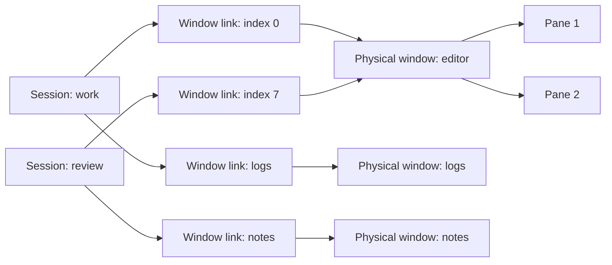

<!-- libtmux-logo -->
<div align="center">
  <picture>
    <source srcset="docs/assets/logo.svg" type="image/svg+xml">
    
  </picture>
</div>
<!-- /libtmux-logo -->

<div align="center">

# libtmux-lisp

</div>

Capture and automate tmux workspaces in native Common Lisp. Acquire a CLOS
object graph once, process its panes with ordinary sequences, and make
mutations through an explicit client.

**Implemented:** captured sessions, physical windows, window links and panes;
bounded subprocess transport; cancellation; named operations, byte buffers,
validated native queries, eager QuerySets, optional regex and bounded JSON;
[bounded declarative workspaces](docs/workspaces.md) with pure plans, explicit
apply and an explicit-endpoint CLI;
[typed option, hook and environment mutations](docs/operations.md#configuration-mutations)
for the exact reviewed tmux catalogs through 3.8; explicit entity and server
termination with retained outcome evidence.
**In development:** decoded configuration readers, control/events and streaming.
MCP is intentionally out of scope. The `0.1.0`
systems are unreleased.

## Install from source

Use Linux x86-64 (including WSL), kernel 6.9+, Bash and a native tmux binary.
The supported tmux range is 3.3a through 3.8, including intermediate releases.
Plain tmux 3.3 is rejected. The pinned toolchain is SBCL 2.6.10,
ASDF/UIOP 3.3.7 and Qlot 1.8.4. The
[process requirements](docs/transport.md#supported-process-boundary) also apply
to WSL; its distribution name alone does not establish kernel capabilities.

Core and query loading require ASDF/UIOP only. Mise reproduces the contributor
toolchain; Qlot installs development and optional dependencies. ASDF is the
Common Lisp build system.

```console
$ git clone https://github.com/libtmux/libtmux-lisp.git && cd libtmux-lisp
```

In an existing SBCL application with ASDF loaded, register this checkout from
its root:

```lisp
(asdf:load-asd (truename "libtmux.asd"))
```

Load core and its local query API:

```lisp
(asdf:load-system "libtmux/query")
```

To reproduce the pinned contributor environment and run all optional examples,
use [mise 2026.11.3+](https://mise.jdx.dev/getting-started.html).
Review [mise.toml](mise.toml), then trust the checkout:

```console
$ mise trust
```

```console
$ mise install
```

Install the locked dependencies. This is the network step:

```console
$ mise run setup
```

Run the complete workspace example. It creates a private tmux socket, checks
the results and removes its daemon; it never addresses your default server.

```console
$ mise run examples
```

Success includes `EXAMPLES PASS: graph, links, native, compiled, relation,
regex and JSON selection, declarative workspace, false/presence, ownership,
refresh, bytes, capture, close, terminate`. Core and query loading need ASDF/UIOP only; optional
regex/JSON use the locked CL-PPCRE/Jzon systems. The example runner also needs
Python 3. No Java runtime is involved.

## Inspect a workspace

The [REPL tutorial](docs/tutorial.md) loads the example package, whose local
nickname `tm` refers to `libtmux`. This complete function returns ordinary
owned data after closing its client:

<!-- example:inventory -->
```lisp
(defun inspect-workspace (socket-path &key (program "tmux"))
  "Acquire one graph from SOCKET-PATH; return owned session/window/pane data."
  (tm:with-client (client :program program :socket-path socket-path)
    (let ((snapshot (tm:fetch-snapshot client)))
      (loop for session across (tm:sessions snapshot)
            collect
            (list :session (tm:name session)
                  :windows
                  (loop for link across (tm:window-links session)
                        for window = (tm:window link)
                        collect (list :index (tm:index link)
                                      :name (tm:name window)
                                      :panes (map 'list #'tm:entity-data
                                                  (tm:panes window)))))))))
```
<!-- /example -->

[libtmux:fetch-snapshot](docs/api.md#fetch-snapshot-function) contacts tmux.
Traversal and projection inside the loops are
local. Returned strings and sequence containers belong to the caller.
Acquisition spans an interval; it is not a transaction over a changing daemon.

The [walkthrough](docs/tutorial.md#build-a-linked-workspace) also creates two
sessions, splits a pane and links one physical window into both sessions:



Select a **window link** when session/index context matters. Rename the physical
window to affect every link. Refresh returns a new observation; earlier captures
retain their values. See [identity and ownership](docs/captures.md).

Process the retained capture with ordinary Lisp. This function uses only local
accessors and returns a list of owned pane data:

<!-- example:selection -->
```lisp
(defun wide-active-panes (snapshot)
  "Select captured active panes at least 40 cells wide; no tmux commands."
  (loop for pane across (tm:panes snapshot)
        when (and (tm:active-p pane) (>= (tm:width pane) 40))
          collect (tm:entity-data pane)))
```
<!-- /example -->

## Compile a local query

The tutorial's example package gives `libtmux` and `libtmux.query` the local
nicknames `tm` and `q`. This checked function compiles once, filters a captured
vector locally, and returns ordinary owned data:

<!-- example:query -->
```lisp
(defparameter *wide-active-filter*
  (q:compile-filter
   :pane
   '(:and (:= :pane/active t)
          (:>= :pane/width 40))))

(defun wide-active-pane-data (snapshot)
  "Return owned data for captured active panes at least 40 cells wide; no I/O."
  (map 'vector #'tm:entity-data
       (q:matching *wide-active-filter* (tm:panes snapshot))))
```
<!-- /example -->

`matching` returns a fresh simple vector and preserves order and duplicates.
The compiler owns mutable operands, rejects cycles and mistyped fields, and
never evaluates query data. Scalar filtering performs no tmux calls. Read the
[query guide](docs/queries.md) for presence, limits, inspection and strict
cardinality.

Relations traverse the same captured graph. This checked query follows session
links to physical windows and panes, then uses the eager local QuerySet:

<!-- example:relation -->
```lisp
(defparameter *active-session-filter*
  (q:compile-filter
   :session
   '(:any :session/window-links
     (:is :link/window
      (:any :window/panes
       (:= :pane/active t))))))

(defun active-session-data (snapshot)
  "Return owned data for sessions with an active pane; no I/O."
  (map 'vector #'tm:entity-data
       (q:items
        (q:where (q:from (tm:sessions snapshot) :model :session)
                 *active-session-filter*))))
```
<!-- /example -->

## Declare and apply a workspace

The optional `libtmux/workspace` ASDF system reads a closed, bounded JSON
document, plans locally, and applies only through an explicit client. The
shipped [`workspace.json`](examples/workspace.json) creates two windows and
three panes from argv arrays. This tested function returns both the inspectable
plan and retained application evidence:

<!-- example:workspaceconfig -->
```lisp
(defun apply-workspace-document (client pathname)
  "Plan and apply one bounded workspace document through explicit CLIENT.
Return the local plan steps and retained application result as two values."
  (let* ((workspace (ws:read-workspace pathname))
         (snapshot (tm:fetch-snapshot client))
         (plan (ws:plan-workspace workspace snapshot)))
    (values (ws:plan-steps plan)
            (ws:apply-workspace client workspace))))
```
<!-- /example -->

An exact second apply returns an empty plan and no command outcomes. A conflict
fails before dispatch. A partial failure retains the failed step and every core
outcome; no mutation is retried or rolled back. The CLI's `validate` and `plan`
modes need no daemon, while `apply` requires `--socket-path`. Read the
[workspace guide](docs/workspaces.md) and
[generated workspace API](docs/workspace-api.md).

## Add regex and a versioned filter document

Optional systems keep core/query dependency-free while providing a compiled
CL-PPCRE scanner and a bounded native JSON envelope. These checked definitions
match the demo's `cat` panes, serialize the filter, read it with explicit regex
permission, and evaluate the restored predicate against the same capture:

<!-- example:regex -->
```lisp
(defparameter *cat-command-filter*
  (q:compile-filter
   :pane
   '(:regex-full-match :pane/current-command
     (:cl-ppcre "CAT" :case-insensitive-mode t))))

(defun cat-pane-data (snapshot)
  "Return owned data for captured panes whose command is exactly cat; no I/O."
  (map 'vector #'tm:entity-data
       (q:matching *cat-command-filter* (tm:panes snapshot))))
```
<!-- /example -->

<!-- example:filterdocument -->
```lisp
(defun round-trip-filter-document (snapshot)
  "Round-trip the checked regex filter and apply it to one retained snapshot."
  (let* ((document (j:write-filter *cat-command-filter*))
         (restored (j:read-filter document :allow-regex t)))
    (values document
            (map 'vector #'tm:entity-data
                 (q:matching restored (tm:panes snapshot))))))
```
<!-- /example -->

The JSON decoder rejects duplicates, unknown names, null operands and exhausted
input/depth/node/string/membership/numeric bounds. It never interns external
names. See [optional query interchange](docs/query-interchange.md).

## Find the right guide

| Task | Start here |
| --- | --- |
| Load the library; inspect and build a workspace | [REPL tutorial](docs/tutorial.md) |
| Filter with `loop`, handle false/absence, export plists | [Local data recipes](docs/tutorial.md#select-and-project-locally) |
| Compile typed filters, traverse relations and compose QuerySets | [Native queries](docs/queries.md) · [Query API](docs/query-api.md) |
| Add CL-PPCRE or exchange bounded filter documents | [Query interchange](docs/query-interchange.md) · [JSON API](docs/json-api.md) |
| Validate, plan or explicitly apply a declarative workspace | [Workspaces](docs/workspaces.md) · [Workspace API](docs/workspace-api.md) |
| Rename, resize, move, send input, capture, use buffers or terminate explicit targets | [Operation contracts](docs/operations.md) |
| Look up signatures, multiple values and conditions | [Public API](docs/api.md) · [Captured fields](docs/fields.md) |
| Understand deadlines, cancellation and cleanup | [Transport](docs/transport.md) |
| Evaluate async, streaming and performance support | [Capabilities and limits](docs/capabilities.md) |
| Rerun FiveAM tests at the REPL or inspect CI coverage | [Testing](docs/testing.md) · [Verification](verification.md) |
| Navigate all documentation | [Guide index](docs/index.md) |

Public calls block. Each client accepts one external operation at a time;
concurrent reuse signals `client-busy`. Internal nonblocking pipe service does
not provide an asynchronous application API. Closing a client releases its
resources and leaves tmux running. [`kill-server`](docs/api.md#kill-server-function)
is a separate explicit operation that proves the daemon accepted during its
preflight exited. Daemon bootstrap currently requires tmux itself; the tutorial
supplies the complete setup and cleanup.

Named mutations preserve dispatch evidence and separate successful changes
from follow-up observation failures. Inspect
[command-outcome](docs/api.md#command-outcome-type) or the condition's
[error-outcome](docs/api.md#error-outcome-function); never retry an uncertain
mutation blindly. See
[outcome handling](docs/tutorial.md#handle-command-and-observation-outcomes).

The examples are shipped source, executed on isolated servers and checked for
excerpt drift. All tmux releases from 3.3a through 3.8 are supported. CI uses the
latest stable SBCL pin and tests only the range's endpoints, 3.3a and 3.8, to
reduce build time. No benchmark result is claimed.

For changes, read [Contributing](.github/CONTRIBUTING.md) and
[Writing](.github/WRITING.md). Licensed under [MIT](LICENSE).

[Branding assets](docs/branding.md) include the logo, icons, and social cards.
