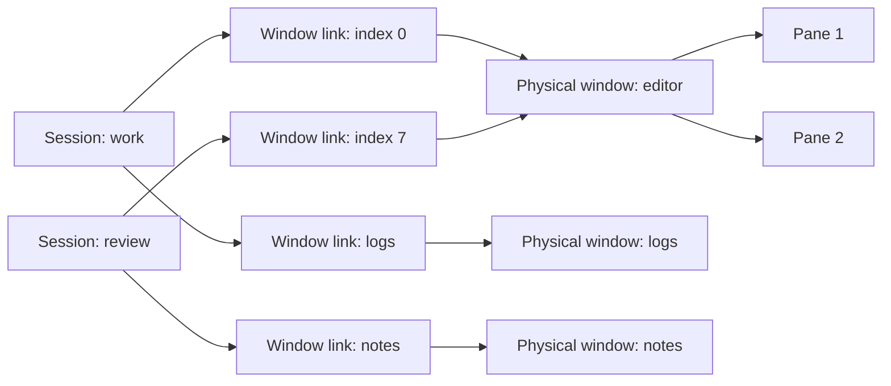

<!-- libtmux-logo -->
<div align="center">
  <picture>
    <source srcset="docs/assets/logo.svg" type="image/svg+xml">
    
  </picture>
</div>
<!-- /libtmux-logo -->

<div align="center">

# libtmux-lisp

[](https://github.com/libtmux/libtmux-lisp/actions/workflows/tests.yml)
[](https://libtmux.org/en/lisp/)
[](https://github.com/libtmux/libtmux-lisp/blob/master/LICENSE)

</div>

Drive tmux from Common Lisp: [sessions][api-session], [windows][api-window],
[window links][api-window-link] and [panes][api-pane] as CLOS objects, queried
with plain sequences, changed through an explicit [`client`][api-client].

[Documentation](https://libtmux.org/en/lisp/) ·
[API reference](https://libtmux.org/en/lisp/latest/reference/) ·
[REPL tutorial](docs/tutorial.md)

**Contents** — [Install](#install-from-source) ·
[Start a server](#start-a-private-server) ·
[Find things](#find-sessions-windows-and-panes) ·
[Query](#query-a-snapshot) ·
[Workspaces](#build-a-workspace) ·
[Systems](#choose-an-asdf-system) ·
[Status](#support-and-status) ·
[Guides](#find-the-right-guide)

## Install from source

Needs SBCL, Linux (WSL included) and tmux 3.3a or newer. Not released yet:
load it from a checkout.

```console
$ git clone https://github.com/libtmux/libtmux-lisp.git && cd libtmux-lisp
```

Register the checkout with ASDF, from its root:

```lisp
(asdf:load-asd (truename "libtmux.asd"))
```

Load core and queries. Both need only ASDF/UIOP:

```lisp
(asdf:load-system "libtmux/query")
```

To run the examples, set up the toolchain with
[mise](.github/CONTRIBUTING.md), then:

```console
$ mise run examples
```

The examples run on a private tmux socket, never your default server.

## Start a private server

### [`libtmux:with-daemon`][api-with-daemon]: a server that cleans up after itself

[`with-client`][api-with-client] scopes the connection;
[`new-session`][api-new-session] creates a session.

<!-- example:managed -->
```lisp
(defun inspect-owned-workspace (&key (program "tmux"))
  "Start an isolated daemon; return owned pane data after closing both resources."
  (libtmux:with-daemon (daemon :program program)
    (libtmux:with-client (client :program (libtmux:daemon-program daemon)
                                 :socket-path (libtmux:daemon-socket-path daemon))
      (let ((outcome (libtmux:new-session client :name "demo" :command '("/bin/cat"))))
        (when (libtmux:outcome-observation-error outcome)
          (error (libtmux:outcome-observation-error outcome))))
      (map 'list #'libtmux:entity-data
           (libtmux:panes (libtmux:fetch-snapshot client))))))
```
<!-- /example -->

```console
$ mise exec -- tools/lisp.sh examples/managed-daemon.lisp
```

Prints `MANAGED DAEMON PASS` and a pane record. To reach an existing server,
use `with-client` alone. More: [daemon scopes](docs/daemons.md).

## Find sessions, windows and panes

### [`libtmux:fetch-snapshot`][api-fetch-snapshot]: read the graph once

One call to tmux; everything after is local.

<!-- example:inventory -->
```lisp
(defun inspect-workspace (socket-path &key (program "tmux"))
  "Acquire one graph from SOCKET-PATH; return owned session/window/pane data."
  (tm:with-client (client :program program :socket-path socket-path)
    (let ((snapshot (tm:fetch-snapshot client)))
      (loop for session across (tm:sessions snapshot)
            collect
            (list :session (tm:name session)
                  :windows
                  (loop for link across (tm:window-links session)
                        for window = (tm:window link)
                        collect (list :index (tm:index link)
                                      :name (tm:name window)
                                      :panes (map 'list #'tm:entity-data
                                                  (tm:panes window)))))))))
```
<!-- /example -->

A window can be linked into several sessions:



More: [identity and ownership](docs/captures.md) ·
[walkthrough](docs/tutorial.md#build-a-linked-workspace).

### [`libtmux:panes`][api-panes]: filter with plain Lisp

<!-- example:selection -->
```lisp
(defun wide-active-panes (snapshot)
  "Select captured active panes at least 40 cells wide; no tmux commands."
  (loop for pane across (tm:panes snapshot)
        when (and (tm:active-p pane) (>= (tm:width pane) 40))
          collect (tm:entity-data pane)))
```
<!-- /example -->

## Query a snapshot

`tm` and `q` are local nicknames for `libtmux` and `libtmux.query`.

### [`libtmux.query:compile-filter`][api-compile-filter]: a filter compiled once

[`matching`][api-matching] applies it to captured objects. No tmux calls.

<!-- example:query -->
```lisp
(defparameter *wide-active-filter*
  (q:compile-filter
   :pane
   '(:and (:= :pane/active t)
          (:>= :pane/width 40))))

(defun wide-active-pane-data (snapshot)
  "Return owned data for captured active panes at least 40 cells wide; no I/O."
  (map 'vector #'tm:entity-data
       (q:matching *wide-active-filter* (tm:panes snapshot))))
```
<!-- /example -->

Mistyped fields are refused at compile time. More: [query guide](docs/queries.md).

### [`libtmux.query:where`][api-where]: follow relations

Sessions with an active pane, through window links and windows.
[`items`][api-items] returns the matches.

<!-- example:relation -->
```lisp
(defparameter *active-session-filter*
  (q:compile-filter
   :session
   '(:any :session/window-links
     (:is :link/window
      (:any :window/panes
       (:= :pane/active t))))))

(defun active-session-data (snapshot)
  "Return owned data for sessions with an active pane; no I/O."
  (map 'vector #'tm:entity-data
       (q:items
        (q:where (q:from (tm:sessions snapshot) :model :session)
                 *active-session-filter*))))
```
<!-- /example -->

### [`libtmux.json:write-filter`][api-write-filter]: regex and JSON documents

Optional systems add CL-PPCRE matching and a versioned JSON form.
[`read-filter`][api-read-filter] restores a filter.

<!-- example:regex -->
```lisp
(defparameter *cat-command-filter*
  (q:compile-filter
   :pane
   '(:regex-full-match :pane/current-command
     (:cl-ppcre "CAT" :case-insensitive-mode t))))

(defun cat-pane-data (snapshot)
  "Return owned data for captured panes whose command is exactly cat; no I/O."
  (map 'vector #'tm:entity-data
       (q:matching *cat-command-filter* (tm:panes snapshot))))
```
<!-- /example -->

<!-- example:filterdocument -->
```lisp
(defun round-trip-filter-document (snapshot)
  "Round-trip the checked regex filter and apply it to one retained snapshot."
  (let* ((document (j:write-filter *cat-command-filter*))
         (restored (j:read-filter document :allow-regex t)))
    (values document
            (map 'vector #'tm:entity-data
                 (q:matching restored (tm:panes snapshot))))))
```
<!-- /example -->

More: [query interchange](docs/query-interchange.md).

## Build a workspace

### [`libtmux.workspace:make-workspace`][api-make-workspace]: declare windows and panes

Plain Lisp data, or an equivalent [JSON file](examples/owned-workspace.json).
Nothing touches tmux until you apply it.

<!-- example:owneddeclaration -->
```lisp
(defun owned-description ()
  "Describe two windows and three panes without contacting tmux."
  (libtmux.workspace:make-workspace
   '(:schema "libtmux.lisp.workspace/2" :id "demo-workspace"
     :session
     (:id "main" :name "owned-demo"
      :environment #(("DEMO_LABEL" . "hello from Common Lisp"))
      :windows
      #((:id "code" :name "code" :index 2 :layout :tiled
         :panes #((:id "shell" :command #("/bin/cat"))
                  (:id "repl" :command #("/bin/cat"))))
        (:id "logs" :name "logs" :index 5
         :panes #((:id "tail" :command #("/bin/cat")))))))))
```
<!-- /example -->

```console
$ mise exec -- tools/lisp.sh examples/owned-workspace.lisp
```

Preview first, then apply. Changing an existing workspace needs `:reconcile t`.
More: [owned workspaces](docs/workspace-owned.md) ·
[Workspace API][api-workspace] · [legacy schema](docs/workspaces.md).

## Choose an ASDF system

One source distribution, one version, one [changelog](CHANGELOG.md). Load only
what you use:

| System | Use it for | Additional dependencies | API |
| --- | --- | --- | --- |
| `libtmux` | Captures, CLOS objects and explicit tmux operations | ASDF/UIOP | [Core][api-core] |
| [`libtmux/query`](query/README.md) | Native predicates, relations and eager QuerySets | Core | [Query][api-query] |
| [`libtmux/regex`](regex/README.md) | CL-PPCRE search and full-match filters | Query, CL-PPCRE | [Query][api-query] |
| [`libtmux/json`](json/README.md) | Bounded query document interchange | Query, Jzon | [JSON][api-json] |
| [`libtmux/control`](control/README.md) | Queued requests, output streams and reconnection on tmux 3.8+ | Core | [Control][api-control] |
| [`libtmux/workspace`](workspace/README.md) | Owned declarations, drift previews and explicit reconciliation | Core, Jzon | [Workspace][api-workspace] |
| [`libtmux/workspace/cli`](workspace/cli/README.md) | Workspace validation, previews and explicit-endpoint apply | Workspace | [CLI][api-cli] |

Definitions are in [`libtmux.asd`](libtmux.asd); source is in `src/`. Each
heading links to the system's directory on GitHub.

### [`libtmux`](https://github.com/libtmux/libtmux-lisp/tree/master/src): the core library

Captures the CLOS object graph and runs explicit tmux operations through a
[`libtmux:client`][api-client], with ASDF and UIOP alone.

[API reference][api-core] · [Guides](https://libtmux.org/en/lisp/latest/guides/) ·
[REPL tutorial](docs/tutorial.md)

### [`libtmux/query`](https://github.com/libtmux/libtmux-lisp/tree/master/query): native queries

[`libtmux.query:compile-filter`][api-compile-filter] and
[`libtmux.query:matching`][api-matching] filter captured objects without
contacting tmux.

[API reference][api-query] · [README](query/README.md)

### [`libtmux/regex`](https://github.com/libtmux/libtmux-lisp/tree/master/regex): CL-PPCRE operators

Adds search and full-match operators to native queries.

[Query API][api-query] · [README](regex/README.md)

### [`libtmux/json`](https://github.com/libtmux/libtmux-lisp/tree/master/json): bounded filter documents

[`libtmux.json:write-filter`][api-write-filter] and
[`libtmux.json:read-filter`][api-read-filter] exchange a compiled filter as a
versioned JSON document.

[API reference][api-json] · [README](json/README.md)

### [`libtmux/control`](https://github.com/libtmux/libtmux-lisp/tree/master/control): control connections on tmux 3.8+

[`libtmux.control:with-connection`][api-with-connection] scopes a connection
that queues requests and streams pane output.

[API reference][api-control] · [README](control/README.md)

### [`libtmux/workspace`](https://github.com/libtmux/libtmux-lisp/tree/master/workspace): owned workspaces

[`libtmux.workspace:make-workspace`][api-make-workspace] declares a workspace;
previews and reconciliation stay explicit.

[API reference][api-workspace] ·
[Workspace docs](https://libtmux.org/en/lisp/latest/workspace/) ·
[README](workspace/README.md)

### [`libtmux/workspace/cli`](https://github.com/libtmux/libtmux-lisp/tree/master/workspace/cli): the workspace command line

Validates, previews and applies a workspace against an explicit endpoint.

[API reference][api-cli] · [README](workspace/cli/README.md)

## Support and status

- **Unreleased.** Load it from a checkout; the API may change.
- **Platform.** SBCL on Linux x86-64, WSL included.
  [Process requirements](docs/transport.md#supported-process-boundary).
- **tmux.** 3.3a or newer. [Control connections](docs/control.md) need 3.8.
- **One operation per client.** Calls block; a second concurrent call signals
  [`client-busy`][api-client-busy].
- **Closing a client leaves tmux running.**
  [`kill-server`][api-kill-server] is a separate, explicit call.
- **Mutations return outcomes.** Read the
  [`command-outcome`][api-command-outcome] before retrying.
  [Outcome handling](docs/tutorial.md#handle-command-and-observation-outcomes).
- **In development.** Wider event coverage and source filtering.
  [Capabilities and limits](docs/capabilities.md).

## Find the right guide

| Task | Start here |
| --- | --- |
| Load the library; inspect and build a workspace | [REPL tutorial](docs/tutorial.md) |
| Start and stop a private empty-config daemon | [Daemon scopes](docs/daemons.md) |
| Filter with `loop`, handle false/absence, export plists | [Local data recipes](docs/tutorial.md#select-and-project-locally) |
| Compile typed filters, traverse relations and compose QuerySets | [Native queries](docs/queries.md) · [Query API](docs/query-api.md) |
| Add CL-PPCRE or exchange bounded filter documents | [Query interchange](docs/query-interchange.md) · [JSON API](docs/json-api.md) |
| Create, inspect or explicitly reconcile an owned workspace | [Owned workspaces](docs/workspace-owned.md) · [Workspace API](docs/workspace-api.md) |
| Rename, resize, move, send input, capture, use buffers or terminate explicit targets | [Operation contracts](docs/operations.md) |
| Read typed options, hooks and environment | [Decoded configuration](docs/configuration.md) |
| Inspect native option, hook and environment output | [Configuration inspection](docs/operations.md#configuration-inspection) |
| Look up signatures, multiple values and conditions | [Public API](docs/api.md) · [Captured fields](docs/fields.md) |
| Understand deadlines, cancellation and cleanup | [Transport](docs/transport.md) |
| Reconnect without replaying commands | [Fresh control observations](docs/control.md#reconnect-with-fresh-observations) |
| Evaluate async, streaming and performance support | [Capabilities and limits](docs/capabilities.md) |
| Rerun FiveAM tests at the REPL or inspect CI coverage | [Testing](docs/testing.md) · [Verification](verification.md) |
| Navigate all documentation | [Guide index](docs/index.md) |

For changes, read [Contributing](.github/CONTRIBUTING.md) and
[Writing](.github/WRITING.md). Licensed under [MIT](LICENSE).

[Branding assets](docs/branding.md) include the logo, icons, and social cards.

[api-cli]: https://libtmux.org/en/lisp/latest/workspace/reference/libtmux-workspace-cli/
[api-client]: https://libtmux.org/en/lisp/latest/reference/libtmux-client/
[api-client-busy]: https://libtmux.org/en/lisp/latest/reference/libtmux-client-busy/
[api-command-outcome]: https://libtmux.org/en/lisp/latest/reference/libtmux-command-outcome/
[api-compile-filter]: https://libtmux.org/en/lisp/latest/reference/libtmux-query-compile-filter/
[api-control]: https://libtmux.org/en/lisp/latest/reference/libtmux-control/
[api-core]: https://libtmux.org/en/lisp/latest/reference/libtmux/
[api-daemon]: https://libtmux.org/en/lisp/latest/reference/libtmux-daemon/
[api-fetch-snapshot]: https://libtmux.org/en/lisp/latest/reference/libtmux-fetch-snapshot/
[api-items]: https://libtmux.org/en/lisp/latest/reference/libtmux-query-items/
[api-json]: https://libtmux.org/en/lisp/latest/reference/libtmux-json/
[api-kill-server]: https://libtmux.org/en/lisp/latest/reference/libtmux-kill-server/
[api-make-workspace]: https://libtmux.org/en/lisp/latest/workspace/reference/libtmux-workspace-make-workspace/
[api-matching]: https://libtmux.org/en/lisp/latest/reference/libtmux-query-matching/
[api-new-session]: https://libtmux.org/en/lisp/latest/reference/libtmux-new-session/
[api-pane]: https://libtmux.org/en/lisp/latest/reference/libtmux-pane/
[api-panes]: https://libtmux.org/en/lisp/latest/reference/libtmux-panes/
[api-query]: https://libtmux.org/en/lisp/latest/reference/libtmux-query/
[api-read-filter]: https://libtmux.org/en/lisp/latest/reference/libtmux-json-read-filter/
[api-session]: https://libtmux.org/en/lisp/latest/reference/libtmux-session-type/
[api-where]: https://libtmux.org/en/lisp/latest/reference/libtmux-query-where/
[api-window]: https://libtmux.org/en/lisp/latest/reference/libtmux-window-type/
[api-window-link]: https://libtmux.org/en/lisp/latest/reference/libtmux-window-link/
[api-with-client]: https://libtmux.org/en/lisp/latest/reference/libtmux-with-client/
[api-with-connection]: https://libtmux.org/en/lisp/latest/reference/libtmux-control-with-connection/
[api-with-daemon]: https://libtmux.org/en/lisp/latest/reference/libtmux-with-daemon/
[api-workspace]: https://libtmux.org/en/lisp/latest/workspace/reference/libtmux-workspace/
[api-write-filter]: https://libtmux.org/en/lisp/latest/reference/libtmux-json-write-filter/
